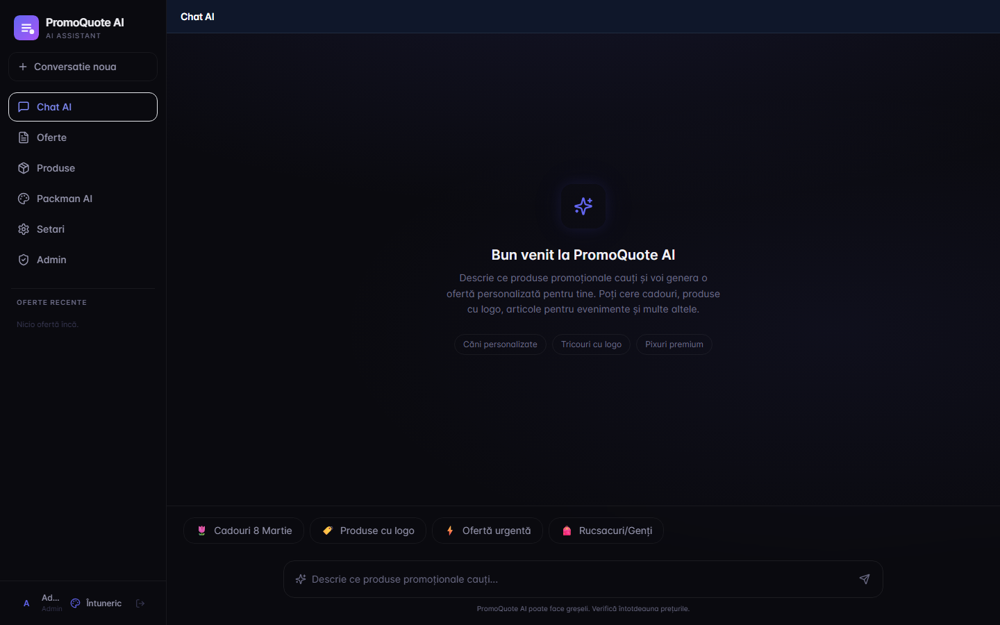
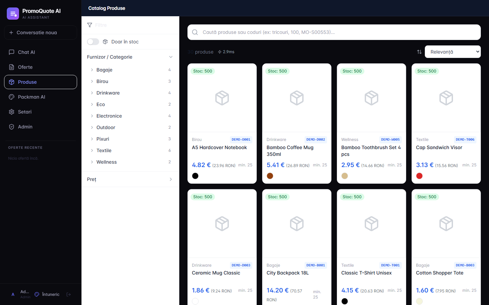
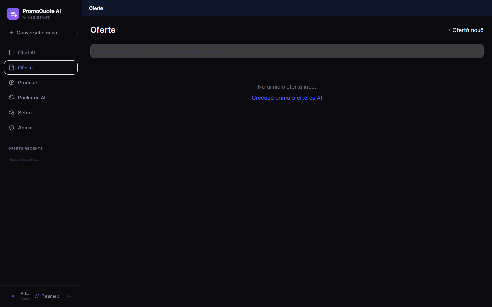

# PromoQuote AI

AI-assisted quotation platform for promotional product distributors. Built around a chat-first workflow: search ~80k products from multiple supplier feeds, build quotes with the AI, lock supplier prices at quote creation, and generate professional PDFs.

<p align="center">
  
</p>

## Why this exists

Distributors juggle dozens of supplier catalogs, fluctuating exchange rates, and per-customer price negotiations. Spreadsheets break, prices drift between quote generations, and clients lose trust when the same product shows two different totals on two PDFs sent a week apart.

PromoQuote AI fixes the drift: every quote **snapshots** its pricing inputs (exchange rate, quantity tiers, discount step) at creation time. PDF regenerations stay byte-for-byte stable for the lifetime of the quote, even if global settings change in the background.

## Features

- **Conversational quote building** — chat assistant searches the catalog, drops products into a side panel, and assembles a quote in real time
- **Multi-supplier catalog** — 13 ready-to-wire integration types (XML feeds, JSON APIs, XLSX imports); credentials configured per-tenant via the UI
- **Virtual client folders** — quote list groups by client with case/diacritic/suffix-insensitive normalization (`MOVEOS` ≡ `Moveos` ≡ `Moveos SRL`)
- **Client autocomplete** — `/api/quotes/clients` endpoint feeds the form: pick a past client, all 3 fields fill in, no duplicate folders created
- **Quantity-tier pricing** — automatic volume discounts (`100/200/300/500/1000` buc with 2% step by default, configurable)
- **Textile mode** — size-aware pricing for apparel: each size has its own EUR price, premiums roll into the per-size unit, tier discount applies on the sum
- **Frozen pricing snapshot** — `exchange_rate`, `quantity_tiers`, `discount_step`, `apply_tier_discount` stored per quote so historical PDFs never drift
- **Client + internal PDF** — branded client-facing offer + detailed internal sheet with cost, margin, profit breakdown
- **Full product detail modal** — every supplier-provided spec rendered with localized labels (dimensions, weight, material, capacity, origin, gender, etc.)
- **PACKMAN AI** — visual product-bundle mockups for clients (no prices, just ideas)

## Architecture

```
┌─────────────────────────┐      ┌──────────────────────┐      ┌───────────────────┐
│  Next.js 14 (App Dir)   │◄────►│   FastAPI + async   │◄────►│  SQLite + WAL     │
│  Tailwind, Zustand,     │ /api │   SQLAlchemy 2.0    │      │  (drop-in PG)    │
│  Framer Motion          │      │                      │      └───────────────────┘
└─────────────────────────┘      │   anthropic SDK     │      ┌───────────────────┐
                                  │   reportlab (PDF)   │◄────►│  Meilisearch      │
                                  └──────────────────────┘      │  (product search) │
                                                                └───────────────────┘
```

- **Frontend:** Next.js 14 App Router, Tailwind, Zustand (with `persist` for draft state across navigation), Framer Motion
- **Backend:** FastAPI + SQLAlchemy async + aiosqlite. Drop-in compatible with PostgreSQL.
- **Search:** Meilisearch with facets, typo tolerance, color/category filters
- **PDF:** reportlab — A4, dual-layout client/internal, custom fonts and brand colors
- **AI (optional):** Anthropic SDK. Quote chat works without it but loses conversational features.

## Quick start (Docker)

```bash
git clone <your-fork-url>
cd promoquote-ai
cp .env.example .env
docker-compose up --build
```

Then open <http://localhost:3000> and seed the demo data:

```bash
docker-compose exec backend python scripts/seed_demo.py
```

Default login (created on first start, change immediately in production):

```
email:    admin@demo.local
password: admin123
```

## Quick start (manual)

**Backend** (Python 3.11+):

```bash
cd backend
python -m venv venv
source venv/bin/activate    # Windows: venv\Scripts\activate
pip install -r requirements.txt
export JWT_SECRET=change-me
uvicorn main:app --reload --port 8000
```

In a second terminal, seed:

```bash
python backend/scripts/seed_demo.py
```

**Frontend** (Node 18+):

```bash
cd frontend
npm install
NEXT_PUBLIC_API_URL=http://localhost:8000/api npm run dev
```

**Meilisearch** is optional. Without it, product search falls back to direct SQL `LIKE` (slower but functional).

## Screenshots

| Chat AI + quote panel | Catalog + product detail |
| --- | --- |
|  |  |

| Quote list with client folders | Generated PDF |
| --- | --- |
|  |  |

> Screenshots reflect the demo seed data. Replace with your own once the system is populated.

## Project layout

```
backend/
  app/
    models/        SQLAlchemy ORM (User, Product, Quote, Integration, …)
    routers/       FastAPI endpoints (quotes, products, ai_agent, sync, …)
    schemas/       Pydantic v2 request/response models
    services/      pdf_service, sync_service (per-supplier parsers), ai_service,
                   search_service, auth_service, unified_taxonomy
  scripts/         seed_demo.py, migrate_unified_categories.py
  main.py          FastAPI app + lifespan + background auto-sync loop

frontend/
  src/
    app/           Next.js routes (chat, quotes, products, settings, brand-kit, admin)
    components/    React components grouped by feature
    lib/           api client, zustand store (persisted), auth context
    types/         shared TypeScript types
```

## Supplier integrations

13 integration parsers live in [`backend/app/services/sync_service.py`](backend/app/services/sync_service.py):

`anda_present`, `easygifts`, `macma`, `midocean`, `roly`, `stamina`, `makito`, `utt`, `promolog`, `sipec`, `bluecollection`, `generic_xml`, `inspirion`.

Each supplier exposes a different format (XML, JSON, XLSX), different price/stock breakdowns, and different printing-option schemas. The parsers normalize everything into `Product` rows with a JSON `specifications` map and `printing_options` array, so the UI renders any supplier uniformly.

Credentials are stored per-integration in the DB (encrypted at rest if you use a Postgres backend with `pgcrypto`). The Settings → Integrations tab exposes a friendly form per integration type.

## Pricing model

`item.unit_price` (EUR cost) + `margin_percent` → `sell_price` (EUR list per unit).

At PDF/UI render time:

```
unit_ron = sell_price × exchange_rate + printing_cost
```

For new quotes (`apply_tier_discount = True`), `unit_ron` and `item.total` automatically apply the quantity tier discount based on `item.quantity` and the per-quote snapshot of `quantity_tiers` + `discount_step`.

For textiles (`size_quantities` present), total qty across sizes determines the tier; each size carries its own EUR premium over the reference price; the discount applies uniformly per size; the displayed unit is the weighted average.

## License

No license file is included — all rights reserved by default. Code is published for evaluation and demonstration. Contact the author for commercial or modification rights.

## Status

This is a portfolio-grade demo. Production-ready features include auth (JWT), PDF generation, multi-supplier sync, and the pricing snapshot system. Hardening still needed before commercial use:

- Database backend (move from SQLite to Postgres)
- Encrypted credentials at rest
- Rate limiting on public endpoints
- E2E test suite
- Containerized deployment with secrets management
